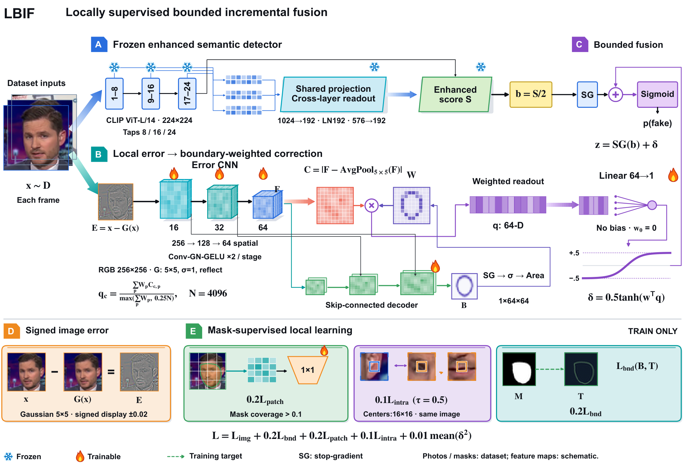
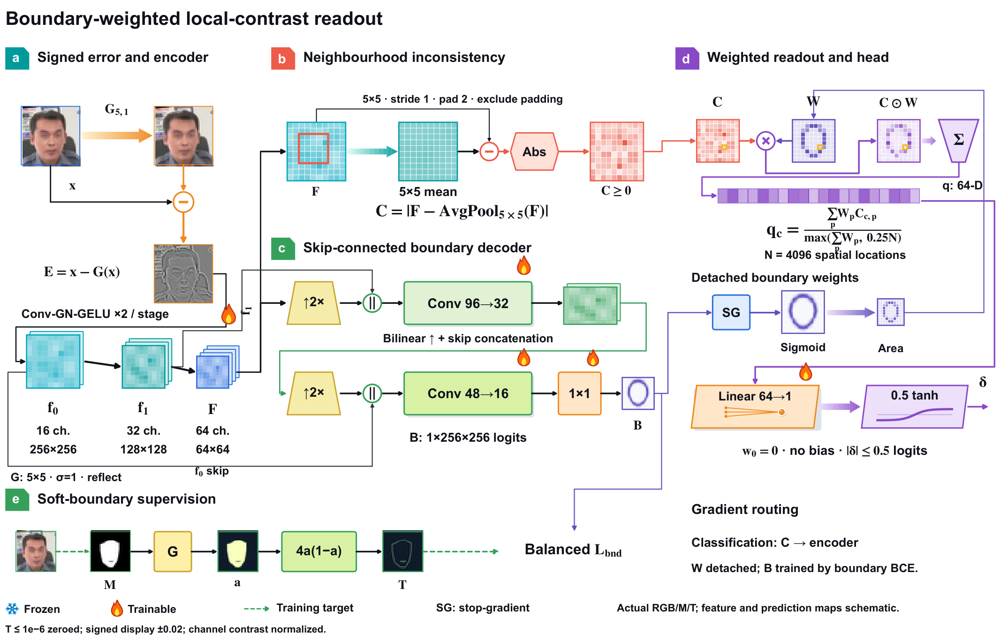
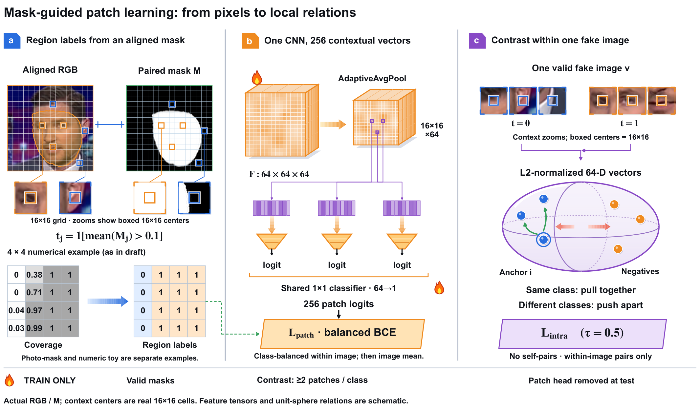

<h1 align="center">局部监督驱动的有界增量融合人脸伪造检测（LBIF）</h1>

<strong>LBIF</strong> Locally Supervised Face Forgery Detection via Bounded Incremental Fusion

  
  
  

  <a href="#method">方法与插图</a> ·
  <a href="#results">实验结果</a> ·
  <a href="#start">开始使用</a> ·
  <a href="docs/CODE_MAP.md">代码导航</a> ·
  <a href="docs/REPRODUCIBILITY.md">复现说明</a>

LBIF 为已经训练好的增强语义检测器增加一条可独立训练的局部取证路径：以掩膜监督学习局部表征，通过零初始化的有界头在输出层施加修正。**语义路径完整冻结，训练可复用语义分数，推理无需真实掩膜。**

- **保留语义基座，增加局部证据。** 新增局部路径包含 **118,722 个训练参数**，无需在这一阶段重训语义路径。
- **区域监督与有界融合。** 有符号高斯误差、边界与块级目标共同组织局部学习，logit 修正限制在 **±0.5** 内。
- **同基座配对评价。** DFD 视频 AUC 为 **97.91%**；所报告六域的种子均值均提高，三个种子的宏平均增量均为正。

## 方法与插图

### 总体框架

冻结的增强语义路径提供固定参照，局部 CNN 从 RGB 与高斯平滑之差中学习细粒度变化。两条路径在 logit 层融合，无需新增逐 token 特征对齐。

  

$$
b(x)=S(x)/2, \qquad z(x)=\mathrm{sg}(b(x))+\delta(x), \qquad
\delta(x)=0.5\tanh(w^\top q).
$$

零初始化使初始预测与语义基线一致；有界头显式限定后续输出修正的幅度。

### 边界加权的局部读出

编码器提取学习特征相对邻域的绝对偏离，预测边界经停止梯度后用于加权聚合。边界解码器在推理阶段保留，真实掩膜仅参与训练。

  

### 掩膜引导的块级学习

有效掩膜提供软边界及块级标签。共享 CNN 生成 16×16 个上下文块向量，联合块级分类与单张伪造图内的区域对比；辅助块分类头不参与推理。

  

三张图使用提供的终版排版直接导出；照片与掩膜为数据示例，特征图、预测响应及向量关系为机制示意。[下载矢量插图 PDF](assets/figures/lbif_figures.pdf) · [方法细节](docs/METHOD.md)

## 实验结果

以 FF++ c23 为源域，在 CDF1、CDF2、DFD、DFDC、DFDCP 与 Wild 六个目标域上评价。所有内部配对使用种子 2027、3407、4099、同一语义基座及固定帧清单。

### 视频级检测

| 目标域 | 增强语义基线 | LBIF | Δ（pp） |
| :--- | ---: | ---: | ---: |
| CDF1 | 85.98 ± 1.94 | **86.66 ± 1.98** | +0.676 |
| CDF2 | 89.36 ± 0.13 | **89.51 ± 0.08** | +0.155 |
| DFD | 97.78 ± 0.29 | **97.91 ± 0.24** | +0.132 |
| DFDC | 84.46 ± 0.40 | **84.51 ± 0.37** | +0.059 |
| DFDCP | 87.68 ± 0.35 | **87.85 ± 0.31** | +0.172 |
| Wild | 87.97 ± 0.65 | **88.21 ± 0.56** | +0.240 |
| **六域 Macro** | 88.870 ± 0.411 | **89.109 ± 0.375** | **+0.239** |

AUC 单位为 %，数值为均值 ± 三种子样本标准差；Δ 按未舍入结果计算，单位为百分点。Macro 为上述六域等权平均。数据对应论文表1。

逐帧六域 Macro 从 **83.756%** 提高至 **84.089%**。匹配控制中，完整配置较 RGB 输入控制和关闭联合块级目标的控制分别提高 **0.255** 与 **0.172** 个百分点。

[完整实验协议与消融](docs/EXPERIMENTS.md) · [结构化结果](docs/results/paper_results.json)

## 开始使用

    git clone https://github.com/wuwu-new/LBIF.git
    cd LBIF
    python tools/verify_snapshot.py

源码核验仅依赖 Python 标准库，检查 411 份原快照文件的哈希及 Python、JSON 格式，无需 GPU 或训练数据。

原运行环境为 Linux、Python 3.10.8、PyTorch 2.3.0+cu118。训练与推理所需的数据、权重、原路径及注册关系见 [复现说明](docs/REPRODUCIBILITY.md)；本仓库保留冻结实验源码的原始内容。

## 仓库导航

| 内容 | 位置 |
| :--- | :--- |
| 三张方法插图及矢量原图 | [assets/figures](assets/figures/) |
| 方法、实验与复现文档 | [docs](docs/README.md) |
| 完整模型、推理、五项匹配消融及语义基座 | [remote_runs](remote_runs/) |
| 原快照依赖源码 | [external_code](external_code/) |
| 来源、环境与 SHA256 清单 | [reproducibility](reproducibility/) |
| 源码核验工具 | [tools/verify_snapshot.py](tools/verify_snapshot.py) |

本代码版本来自 2026年11月9日核验的“代码第一版”。数据集图像、掩膜、模型权重和语义分数缓存不随仓库分发；来源与许可见 [快照说明](docs/SNAPSHOT.md)、[LICENSE](LICENSE) 和 [第三方说明](THIRD_PARTY_NOTICES.md)。
